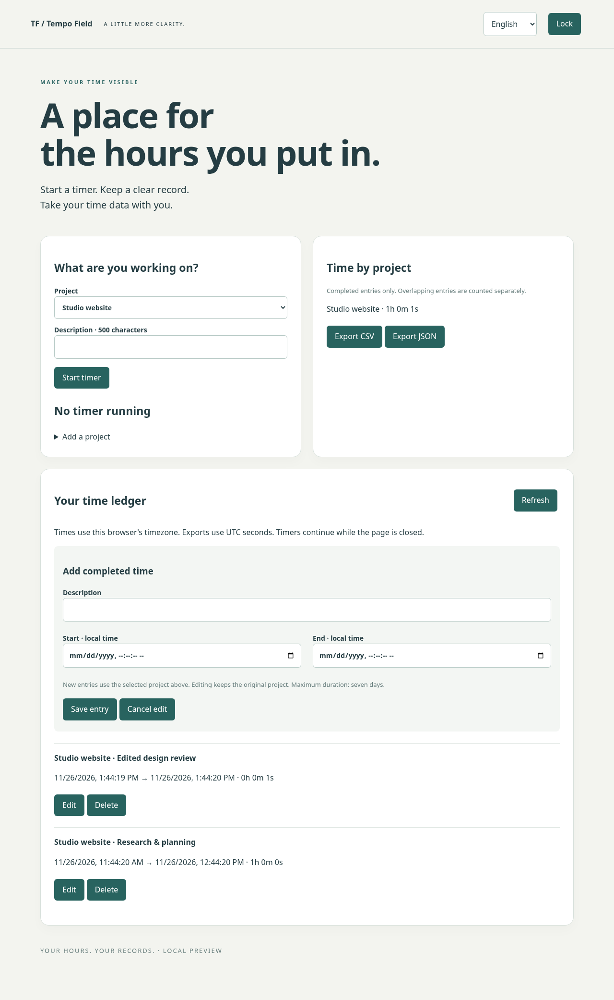

# Tempo Field

### A place for the hours you put in.

A self-hosted alternative to Toggl Track for a single person's projects, timers, manual time entries and portable exports. Python + SQLite. [MIT licensed](LICENSE).



**Local six-language preview — not a public release.** Six-language support, container recovery acceptance and public HTTPS acceptance are pending. No hosted demo is available.

## A clear record of your day

1. Create a project and describe the work. Start one timer; it continues while the browser is closed.
2. Stop the timer or add completed time manually. Correct an entry's description and times, or delete it with confirmation.
3. See completed time by project. Download CSV for a spreadsheet or JSON for your records.

Totals include overlapping entries separately. A running timer is excluded until stopped. No idle detection, background activity monitoring, billing, payroll, team permissions, integrations or full Toggl parity is claimed.

## Run locally

Requires Python 3.12. Unpack the development package, then:

```sh
python3 -m venv .venv
. .venv/bin/activate
pip install -r requirements.txt
python3 scripts/setup.py
set -a
. ./.env
set +a
python server.py
```

Open **http://127.0.0.1:8118** and unlock with the `TEMPO_OWNER_KEY` from your private `.env`. The key stays in browser memory; reloading locks the workspace. Do not share or commit it. Data persists in `tempo.sqlite3`.

For the included container configuration, run `docker compose up --build -d` after setup. This configuration has not yet passed container recovery acceptance. See [operations](docs/DEPLOYMENT.md).

## Know the boundaries

- Single owner, up to 200 projects and 10,000 entries. Descriptions are limited to 500 characters. Projects cannot yet be renamed or deleted.
- Completed entries must be in the past and no longer than seven days. An overlong timer must be corrected manually.
- Timer duration follows the host's wall clock; sleep and browser closure count as time. Clock changes can require manual correction. It is not a monotonic billing clock.
- Manual inputs use your browser's local timezone. Repeated daylight-saving hours cannot be explicitly disambiguated in this preview. Exports use UTC epoch seconds.
- JSON export is a record format, not an import/restore tool. Back up SQLite for recovery. CSV prefixes formula-like user text with an apostrophe for spreadsheet safety.
- Concurrent starts are serialized by SQLite. Editing from multiple tabs uses the last saved values; refresh before editing.

## Checks and contribution

```sh
python -m unittest discover -s tests -v
```

Tests cover concurrent timers, persistence, input validation, corrections, authentication and spreadsheet-safe export. Browser acceptance uses synthetic records; see [validation](artifacts/validation.json). Report reproducible bugs without owner keys or personal time records.

[Scope and comparison](docs/SCOPE.md) · [Operations](docs/DEPLOYMENT.md) · [License](LICENSE)

Fresh acceptance (26 November): 14 Python tests, English workflow and five translated browser workflows, catalog parity, non-root container restart and fresh-volume restoration. Run `npm ci`, `npx playwright install chromium`, and `npm run test:browser` in the activated Python environment; `CHROMIUM_PATH` optionally selects an installed browser.

## Source and deployment status

[Independent public repository](https://github.com/anshuman-pandey/tempo-field). Source publication is verified. A public hosted deployment has not been configured or verified. Use the persistent Docker instructions for self-hosting; do not expose the development server.
